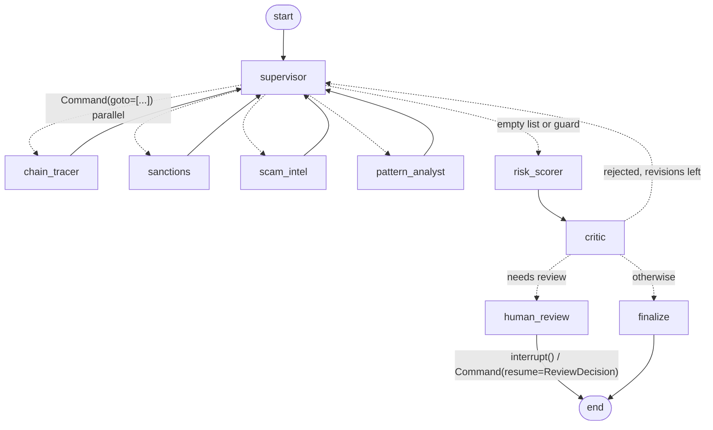

# sentinel.agents — the triage graph

A LangGraph `StateGraph` that turns a `Case` into a `Verdict`. Entry points:
`build_graph(ports, models, settings, checkpointer)`, `run_case(graph, case)` and
`resume_case(graph, thread_id, decision)`.

## Modules

| Module | Role |
|---|---|
| `state.py` | `TriageState` (TypedDict) with reducers for parallel writes; `RouteRecord`, `CriticRequest` |
| `supervisor.py` | structured `RoutingDecision` from the LLM, then deterministic guards |
| `specialists.py` | one ReAct agent per specialist (`langchain.agents.create_agent`), structured `SpecialistAssessment` |
| `tools.py` | per-specialist tools and deterministic pre-checks over the ports and the case context; evidence travels as tool artifacts |
| `screening.py` | counterparty screening (sanctions, scam intel, mixers) and flow features (age, fresh funders, peel chain) |
| `structured.py` | `ask_structured`: typed structured output with one corrective retry |
| `risk_scorer.py` | hard rules (table in the module docstring) + LLM summary -> draft `Verdict` |
| `critic.py` | deterministic evidence check + LLM claim check; bounded send-back |
| `review.py` | `interrupt()` with a compact payload; applies the `ReviewDecision` |
| `graph.py` | wiring, checkpoint serializer allowlist, `run_case` / `resume_case` |
| `prompts.py` | all system prompts and state-to-text renderers |

## Design trade-offs

**Why a supervisor.** Cases differ: a sanctions hit makes deep chain tracing
pointless, a fresh address needs pattern matching. A supervisor routes per case
instead of running a fixed pipeline, and its `RoutingDecision.reason` gives an
audit trail (`routing_history`). Independent specialists are sent together in one
`Command(goto=[...])`, so they run in parallel in one superstep; reducers on
`findings` and `routing_history` make the parallel writes safe. The cost is one
extra LLM call per step; a fixed fan-out would be cheaper but blind.

**Why ReAct inside specialists.** Each specialist has two or three tools and a
short, open-ended job (for example: look up the counterparty after seeing the
transfers). A ReAct loop fits that: the model picks the next tool from what it just
saw. Tools return `(content, artifact)`; the `Finding.evidence` list is built from
the artifacts, never from model text, so a specialist cannot cite evidence it did
not retrieve. Each specialist sees only its own tools, which keeps prompts small and
makes tool choice errors local.

**Mandatory screening.** `sanctions`, `scam_intel` and `chain_tracer`
(`supervisor.MANDATORY`) always run before `risk_scorer`; `chain_tracer` is included
because the destination's history and the look-alike check matter for every withdrawal.
Whenever the case would go to scoring (the LLM says so, or a guard trips, including `max_steps`), the supervisor first routes to any of them that has
not run, without an LLM call. Compliance checks never depend on a model's choice.

**Look-alike check (address poisoning).** `chain_tracer` has a deterministic tool,
`compare_with_known_addresses`, that compares the destination with the addresses in the
case's `account_context` (`recent_withdrawal_addresses`, `address_book`). Same first 4 and
last 4 hex characters but a different address gives `lookalike_match` evidence (with the
actual common prefix/suffix lengths); otherwise `lookalike_clear`. The tool reads the case
from the agent's runtime context (`SpecialistContext`), so the model only passes the
address and cannot change the comparison set.

**Pre-checks.** Specialists that run mandatory screening first run deterministic
checks on the destination, before their ReAct loop, and get the results in their task
message: `chain_tracer` runs the look-alike check and `flow_features`, `sanctions` and
`scam_intel` screen the counterparties. The evidence always lands in the finding, so
the rules below never depend on a model deciding to call a tool. The same checks are
also tools, so a model can apply them to other addresses (e.g. a counterparty).

**Counterparty screening and flow features** (`screening.py`). Indirect risk is in
who funded the destination and where its money went. The top 5 counterparties by
value are screened against sanctions and scam intel and checked for mixer labels
(`MIXER_MARKERS`, e.g. explorer contract names containing "Tornado"). Flow features
summarize age at request time, inflow/outflow, the share of inflow from addresses
younger than 7 days, and a peel-chain signal. Amounts are compared within the
primary asset only (no prices); zero-value transfers are ignored.

**Rules** (`risk_scorer.py`, first match wins; the reasoning for each threshold is in
the module docstring):

| Rule | Evidence | Level | Score | Action |
|---|---|---|---|---|
| sanctions_hit | `sanctions_hit` | critical | 100 | block |
| scam_report | `scam_report`, category drainer / phishing / address_poisoning | high | 90 | block |
| lookalike | `lookalike_match` | high | 85 | block |
| counterparty_sanction | `counterparty_sanctions_hit`, exposure >= 10% (high at >= 50%) | medium / high | 70 / 80 | hold (floor) |
| counterparty_mixer | `counterparty_mixer`, exposure >= 20% | medium | 65 | hold (floor) |
| peel_chain | `flow_features.peel_chain` (dominant inflow, >= 4 hops of <= 30% of the remainder to fresh addresses) | medium | 65 | hold (floor) |
| fresh_inflow | destination < 7 days old, >= 50% of inflow from >= 2 fresh funders, and an unusual withdrawal for the account | medium | 60 | hold (floor) |
| no_findings | no findings at all | medium | 50 | hold_for_review |
| — | anything else | LLM | LLM | LLM |

Block rules fix the outcome. Floor rules set a minimum: the LLM may escalate (for
example to block) but not go below.

**Structured output.** `ask_structured` (supervisor, scorer, critic) retries once
with the validation error appended, then raises `StructuredOutputError`. Specialists'
final answer uses `ToolStrategy`, which already feeds validation errors back to the
model, bounded by `SPECIALIST_RECURSION_LIMIT`.

**Time.** The case text includes `Requested at` (UTC); prompts tell models to judge
recency relative to it, so results do not depend on a model's idea of today.

**Checkpoint-safe evidence.** msgpack cannot store integers outside the signed 64-bit
range (wei balances often are), so tools store those as decimal strings in
`Evidence.data`.

**Loop guards.** Every loop has a hard bound that does not depend on the model:

- supervisor: `settings.max_steps` LLM routing decisions, then straight to scoring;
- no repeat calls: a specialist runs once, unless the critic asked for it in the
  current revision round (`available_specialists`); if nothing is left, score;
- critic: at most `settings.max_revisions` send-backs, then the draft goes forward
  with the open issues recorded in `critic_issues` (shown to the human reviewer);
- specialist ReAct loop: `SPECIALIST_RECURSION_LIMIT`; hitting it yields a
  zero-confidence finding instead of failing the case.

**Rules before models.** The highest-impact outcomes (sanctions hit, known drainer
or phishing report, look-alike) are fixed by deterministic rules in `risk_scorer.py`,
where the LLM only writes the explanation; indirect risk gets a deterministic floor.
The LLM decides the ambiguous middle, and every
non-allow verdict at or above `review_threshold` pauses for a human.

**Human in the loop and checkpoints.** `human_review` calls `interrupt()`; the
checkpointer stores the paused state, so a reviewer can resume minutes or days
later from another process with the same `thread_id`. Checkpoints use
`checkpoint_serde()`, which allowlists exactly the types stored in the state.

**Where Plan-and-Execute fits (wave 2).** ReAct with a supervisor suits one case at
a time, where the next step depends on the last result. Batch re-review (for
example: re-screen 5,000 past withdrawals after a sanctions list update) is
different: the steps are known up front and the same for every item. There a
planner writes one plan, an executor runs it over the batch with no LLM per step,
and the model is only consulted to re-plan on exceptions. That is cheaper and more
predictable; the evals in wave 2 compare both on the same dataset.
